# Puyo Puyo Sun English (Sega ST-V)

An English translation of the ST-V arcade game *Puyo Puyo Sun* (Compile,
1996, MAME set `puyosun`), as a bootleg clone set `puyosune` for
[mame2003-plus](https://github.com/zanac/mame2003-plus-libretro)
(branch `stv-puyosun-english`).

The Windows version of the game has an English translation patch made by
the [Puyo Nexus](https://www.puyonexus.net) community. This project takes
the English text, font and pictures of that patch and puts them into the
arcade cartridge. The arcade parts the PC patch does not cover (the rules
demonstration, the ranking labels, the side tags) are translated here in
the same style.

All the translation work in the story scenes and the win quotes is from
the Puyo Nexus patch; credit for it goes to its authors.

## Support
Hey dude! Help me out for a couple of :beers: or a :coffee:!<br/>
[](https://bmc.link/zanac)

## Status

| Part | State |
|---|---|
| Win quotes (after each match), all 69 | English, each one checked on screen in the emulator |
| Story scenes, 24 | English, all 24 checked in the emulator |
| Secret last stage against Carbuncle (Schezo course, no continue) and its ending | English, checked in the emulator |
| Game select, character select, practice balloon | English, checked in the emulator |
| Map screen: plaque, character names | English, checked in the emulator |
| In-game: chain tag, YEAH!/OH NO!, All Clear!, Offset, curry labels | English (PC patch pictures), checked in the emulator |
| Side tags: WINS, JOIN OK, COME ON, RIVAL, NO ENTRY | English, checked in the emulator |
| Ranking: difficulty labels, CHAIN | English, checked in the emulator |
| Rules demonstration (attract mode) | English, checked in the emulator |
| "Act Against AIDS" screen (attract mode): slogan and its three lines | English, checked in the emulator |
| Results screen: VS opponent name, MAX CHAIN, Total | English, checked in the emulator |
| Endings of the three courses (Arle, Draco, Schezo): the lines written across in place of the vertical kana | English, checked in the emulator for all three |
| Title logo: "Puyo Puyo" (PC patch picture) | English, checked in the emulator |
| Nohoho's stage: tea signs; the splash "WOOSH" (PC patch pictures) | English |
| Name entry title (Draco, Arle, Schezo) | English, checked in the emulator for all three |
| Two players: challenger, versus fighter select, VS names, handicap, rounds, winner's line | English, checked in the emulator |
| Practice (EASY course, Draco, 3 stages) | English, checked in the emulator |
| Defeat: loser's screen, CONTINUE? countdown, GAME OVER | English, checked in the emulator |
| Service mode: ST-V test menu (BIOS) | English in the original; the game's own test screen draws nothing in mame2003-plus (also with the Japanese set), its texts in the program are English/romaji |
| ROM set `puyosune`, build script, driver entry | done |

Nothing is left in Japanese that we have seen. The "Act Against AIDS"
screen is the logo of a real 1990s charity campaign; its logo, its
English name and its credit are kept, and only the Japanese slogan under
the line is translated.

The story texts use a proportional font: a small patch in the text
engine advances each character by its width from a table, instead of a
fixed step. Page timings were measured per scene, so the English pages
stay on screen as long as the Japanese ones and follow the animation.

## Screenshots

Japanese arcade original on the left, `puyosune` on the right.

| | |
|---|---|
| Game select | 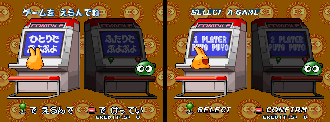 |
| Character select | 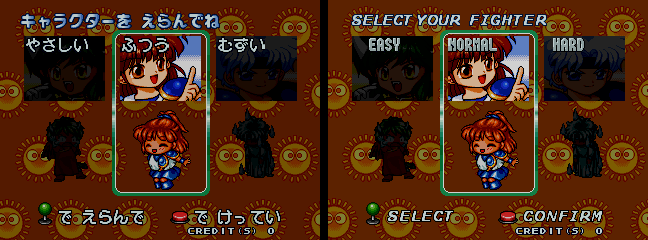 |
| Map | 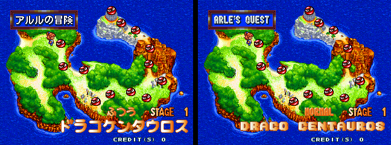 |
| Story scene | 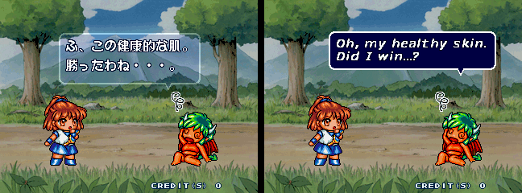 |
| Act Against AIDS | 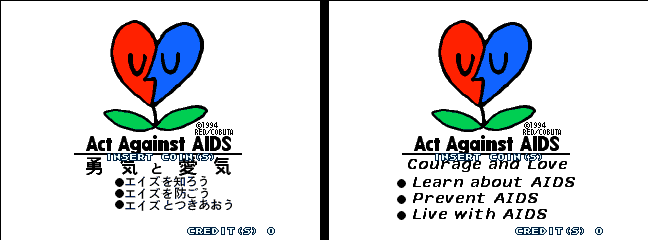 |

`puyosune` only:

| | |
|---|---|
| All Clear! | 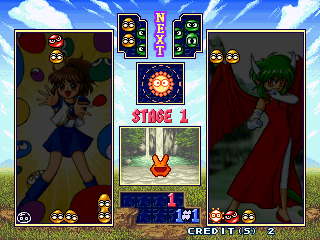 |
| Win quote | 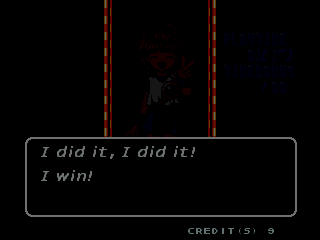 |
| YEAH! / OH NO! | 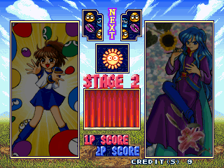 |
| Rules demonstration | 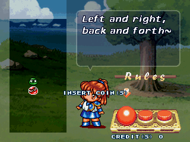 |
| Ranking | 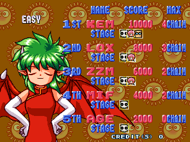 |
| Results | 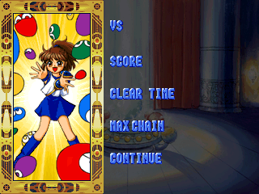 |
| Name entry | 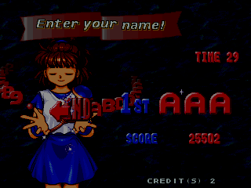 |
| Title | 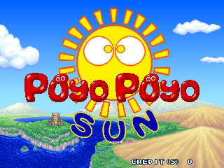 |
| Ending (Arle) | 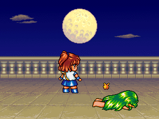 |
| Ending (Draco) | 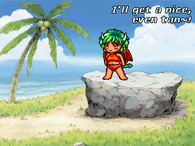 |
| Ending (Schezo) | 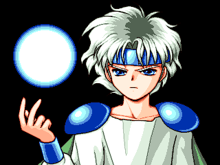 |

## Building the ROM set

You need:

- the MAME `puyosun` set (`puyosun.zip`, the 9 ROMs below are checked by
  CRC);
- Python 3 (standard library only).

The translated assets of the Puyo Nexus patch that the build uses (the
English font, the in-game pictures and the story texts) are in
`assets/puyosune_assets.zip`, so the PC patch is not needed.

```
cd tools
python3 make_puyosune.py puyosun.zip OUT_DIR
```

`OUT_DIR/puyosune.zip` is the whole set (the three new ROMs and the
unchanged mask ROMs). Put it next to `puyosun.zip` and `stvbios.zip` in
the mame2003-plus ROM folder.

Expected output:

| File | Size | CRC32 | SHA1 |
|---|---|---|---|
| pse19531.13 | 0x080000 | e14ff686 | dc370ec338473c5fa3c54831854e0e808e1349f2 |
| pse19533.2 | 0x400000 | 6f534729 | 84f4545d488d88c689f23cc9ca3f54e4d9668371 |
| pse19534.3 | 0x400000 | 09ddbc17 | c6d028a1b926cd725a6c6c541e57b957935c0674 |

Unchanged from `puyosun`: mpr19532.1, mpr19535.4, mpr19536.5,
mpr19537.6, mpr19538.8, mpr19539.9.

## How it works

The tools in `tools/`:

| File | Purpose |
|---|---|
| `make_puyosune.py` | release script: checks the inputs, builds, writes the set |
| `build.py` | the whole build; program decompression and recompression, font, width table, text engine patch |
| `cmpdec.py`, `cmpenc.py` | the LZ format of the program and of the compressed sprite sets |
| `assets.py` | reads `assets/puyosune_assets.zip`, the translated assets of the PC patch |
| `extract_assets.py` | makes `assets/puyosune_assets.zip` from the PC patch (`Puyo_Puyo_Sun__English_Patched_.zip`); only needed to remake it |
| `grpdat.py` | reader of the PC `grp.dat` pictures (used by `extract_assets.py`) |
| `gfx.py` | sprite sets of the cartridge, drawing English lettering into them |
| `quotes.py` | win quotes |
| `story.py`, `windows.py` | story scenes: PC pages matched to the arcade events, page timings |
| `tutorial.py` | rules demonstration texts |
| `menus.py`, `screens.py` | menus, cabinets, character names, map |
| `ingame.py` | in-game pictures from the PC patch and side tags |
| `ranking.py` | ranking labels |
| `results.py` | results screen (MAX CHAIN) |
| `nameentry.py` | name entry titles |
| `ending.py` | the ending lines, written across |
| `aids.py` | the slogan of the "Act Against AIDS" screen |
| `dlgchars.py` | dialogue font codes |

The program is stored compressed in the EPROM and unpacked to work RAM
at boot; it is unpacked, patched and packed again. The arcade sprite sets
match the PC `grp.dat` pictures one to one (set k is PC entry k−1, same
colour numbers), so the PC patch pictures go in directly; sets are
rewritten in place.
